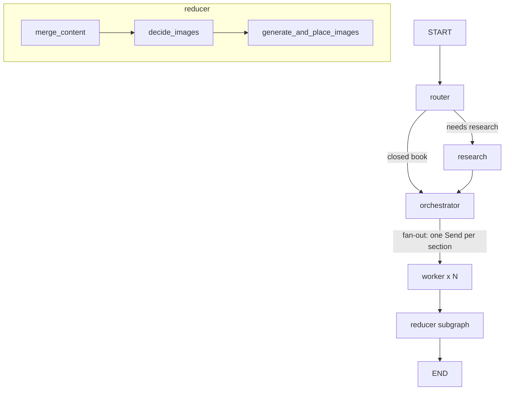

# AI Agent: Blog Writing Agent

A LangGraph-based agent that turns a topic into a complete, structured technical blog post in Markdown. It decides whether web research is needed, gathers evidence, plans the outline, writes every section in parallel, optionally adds generated diagrams, and saves the result. A Streamlit app lets you run it and browse past blogs.

## Features

- **Smart routing**: decides up front between `closed_book` (evergreen), `hybrid` and `open_book` (news / "latest") modes.
- **Web research** with Tavily. Searches run in parallel, results are deduplicated by URL, and evidence URLs are validated against the raw results.
- **Recency-aware**: an *as-of date* and a *recency window* feed the router and (in `open_book` mode) a Tavily start-date filter.
- **Structured planning**: a Pydantic-validated outline of 5-9 sections with goals, bullets and word targets.
- **Parallel section writing** (LangGraph `Send` fan-out) with per-claim citations; a failed section is replaced by a placeholder instead of failing the run.
- **Optional images**: the LLM picks up to 3 places for technical diagrams, code inserts the placeholders, and the images are generated in parallel.
- **Streamlit UI**: live progress, plan / evidence / preview / images / logs tabs, past-blog browser, Markdown and ZIP downloads.

## How it works



| Node | What it does |
|---|---|
| `router` | Chooses the mode and, if needed, 3-10 scoped search queries (aware of today's date). |
| `research` | Runs the queries in parallel, dedupes results, extracts a clean `EvidencePack`. |
| `orchestrator` | Produces the `Plan` (title, audience, tone, sections). Section ids are assigned in code. |
| `worker` | Writes one section in Markdown, following the goal/bullets and citing evidence per claim. |
| `reducer` | Merges sections, decides image placement, generates images, and saves the `.md` file. |

## Project structure

```
AI Agent/
├── Agent_backend.py     # LangGraph pipeline (also runnable from the command line)
├── Agent_frontend.py    # Streamlit UI
├── requirements.txt     # Python dependencies
├── .env.example         # Template for your API keys
├── .gitignore
├── README.md
└── output/              # Created automatically
    ├── <blog_title>.md
    └── images/          # Generated diagrams referenced by the blogs
```

## Setup

1. **Python 3.10+** and a virtual environment (the repo's parent `AgenticAI/.venv` works).

   ```powershell
   cd "D:\VS code Files\AgenticAI"
   .venv\Scripts\activate
   cd "AI Agent"
   pip install -r requirements.txt
   ```

2. **API keys**: copy `.env.example` to `.env` and fill it in.

   ```env
   OPENAI_API_KEY=your-openai-key
   TAVILY_API_KEY=your-tavily-key
   ```

   `.env` is git-ignored. Never commit it.

## Usage

### Streamlit app

```powershell
streamlit run Agent_frontend.py
```

1. Enter a topic in the sidebar (for example "Self-attention in the Transformer architecture").
2. Optionally set the **as-of date** and **recency window** (useful for "this week" style topics).
3. Click **Generate Blog** and watch the progress panel.
4. Review the result in the tabs, then download the Markdown or a ZIP bundle (Markdown + images).

Previously generated blogs appear under **Past blogs** in the sidebar.

### Command line

```powershell
python Agent_backend.py "Self Attention in Transformer Architecture"
```

The blog is saved to `output/`. From Python:

```python
from Agent_backend import run
state = run("State of Multimodal LLMs", recency_days=14)
print(state["final"])
```

## Configuration

Optional environment variables (set in `.env`):

| Variable | Default | Purpose |
|---|---|---|
| `LLM_MODEL` | `gpt-4.1-mini` | Chat model used by every node. |
| `IMAGE_MODEL` | `gpt-image-2.6-sunburst` | Image model used for diagrams. |

Tunable constants at the top of `Agent_backend.py`: `MAX_QUERIES`, `RESULTS_PER_QUERY`, `SNIPPET_CHARS`, `MAX_IMAGES`, `MAX_PARALLEL`.

## Output

- Blogs are saved as `output/<Blog_Title>.md` (a Windows-safe version of the title). Generating the same title again overwrites the file.
- Images are saved in `output/images/` and linked from the Markdown as `images/<name>.png`.

## Cost notes

One run makes several LLM calls (router, research extraction, planning, one per section, image planning) plus up to 3 image generations and up to 10 Tavily searches. Lower `MAX_IMAGES` or `MAX_QUERIES` to reduce cost.

## Troubleshooting

| Problem | Fix |
|---|---|
| "Could not load the backend" in the app | Check `.env` has `OPENAI_API_KEY`, and that dependencies are installed in the active environment. |
| No research evidence | Check `TAVILY_API_KEY`; failed queries are skipped and printed in the terminal. |
| "Image unavailable" in a blog | Image generation failed (model name or quota). Check the terminal output and `IMAGE_MODEL`. |
| Past blogs list is empty | Blogs are read from the `output/` folder next to `Agent_backend.py`. |
| Old blogs show broken images | They were saved before the output folder was unified; move their images into `output/images/`. |

## Limitations

- Citations are only as good as the search snippets; always spot-check numbers and dates before publishing.
- The Tavily date filter applies in `open_book` mode with the `langchain-tavily` package; the older community tool has no date filter.
- Image generation depends on your OpenAI account having access to the configured image model.
